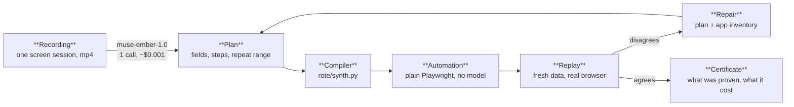

# rote

**Show it once. It does it forever — and proves it.**

`rote` watches a screen recording of a repetitive task in a web app, works out what was done,
writes browser automation for it, and then **proves the automation works by replaying it
against data the recording never contained**.

Built for the [Meta Muse Ember Hackathon](https://cerebralvalley.ai/e/muse-ember-hackathon)
(Nov 23 – Dec 2, 2026). Every model call runs on `muse-ember-1.0` through the Meta Model API.

```bash
# record once (or bring your own recording), then:
python -m rote learn intake.mp4 --url http://127.0.0.1:8765/app.html --rows my_data.json
# → results/learn/intake.py     readable Playwright automation, no model at runtime
# → results/learn/report.md     what it understood, and the replay verdict
# → results/learn/certificate.html
```

## Why this is not another "AI writes scripts" demo

Three decisions do the work:

**The recording teaches the procedure; your data is the input.** So the model never has to
OCR every value perfectly. It has to get the fields, the order and the repeating block right —
which is what a fixed frame budget can still carry. An hour of screen recording costs about
half a cent to read, because video input is billed at roughly 170 tokens regardless of length.

**A compiler writes the code, not the model.** The model's job ends at a plan: fields,
actions, one repeat range. `rote/synth.py` turns that plan into small, readable Python. A
model asked to emit a hundred lines will make a typo; a compiler asked to emit them will not.

**Nothing ships until it has been run.** Replay executes the automation in a real browser with
fresh data and checks what the app actually did. When the first plan is wrong — and on two of
three tasks below, it was — the failure evidence goes back to `muse-ember-1.0`, which fixes
*the plan*, not the code.



## Measured, not claimed

Three tasks, three different apps, fresh data that never appeared in any recording:

| task | app | attempts | model calls | cost | verdict |
|---|---|---|---|---|---|
| Parts intake, two lines | Stockroom (ours) | fail, fail, pass | 3 | $0.02477 | 6/6 checks |
| New vendor, checkbox + date | VendorDesk (ours) | pass | 1 | $0.00126 | 6/6 checks |
| Checkout with login | saucedemo.com (not ours) | fail, pass | 2 | $0.00957 | 4/4 checks |
| **total** | | | **6** | **$0.0356** | 3/3 passed |

Reading three recordings, writing three automations and replaying them all costs **a few cents**.
Evidence lives in `results/submission/`: `report.md` per task, `certificate.html` per task, and
`trace.md` with every call's tokens and cost.

The spread is the honest part: the same three tasks have cost between **$0.0098 and $0.0356**
across runs, because the first plan is sometimes right and sometimes needs repair. The numbers
above are the committed run; a cheaper one is described in the git history. Paying for a repair
is still cheaper than a person doing the task twice.

## What it refuses to do

Honesty is a feature when the alternative is silent corruption:

- **Ambiguous dates are rejected.** `03/01/2026` is either March 1st or January 3rd. rote
  refuses it and asks for `YYYY-MM-DD` rather than guessing.
- **A rejected dropdown value fails loudly**, listing the options that exist.
- **A fill that does not stick raises at that moment**, because many apps never echo what you
  typed anywhere later.
- **A verifier that cannot observe something says so.** When an app ends on a confirmation
  screen that does not echo the data, the check reports "not applicable" instead of inventing
  a pass — and the end state is checked separately.

## Limits, stated plainly

- It works on web apps with labels, placeholders or accessible names. An icon with no
  accessible name is guesswork, and the report will say the step failed.
- Accessible names that move at runtime (`Cart, empty` → `Cart, 1 item`) must be named by
  their stable part; the instructions say so, and the repair evidence shows the real names.
- The repeating block is one contiguous range. A task whose data entry is interleaved with
  unrelated navigation in several places is beyond the current plan model.
- Proof on saucedemo was one row. Fresh *values*, not fresh *row counts*.

## Layout

| path | what it is |
|---|---|
| `rote/` | the product: client, plan, understand, synth, replay, repair, certify, trace, cli |
| `rote/scriptenv.py` | the runtime helpers, embedded into every generated script and used by the recorder, so the two cannot drift |
| `app/` | two small fixtures the recorder runs against. Not the product. |
| `prompts/` | the brief handed to the model, and the Muse Code trajectory |
| `tests/` | 45 tests, `./check.sh` runs them |
| `results/` | the evidence bundle: reports, certificates, trace, generated automations |

## Run it

```bash
python3 -m venv .venv && ./.venv/bin/pip install -r requirements.txt
./.venv/bin/playwright install chromium
python3 -m http.server 8765 --directory app &      # the fixtures
PYTHONPATH=. ./.venv/bin/python -m rote record --url http://127.0.0.1:8765/app.html \
    --rows results/fresh_rows.json
PYTHONPATH=. ./.venv/bin/python -m rote learn results/recordings/intake.mp4 \
    --url http://127.0.0.1:8765/app.html --rows results/fresh_rows.json
```

`MODEL_API_KEY` comes from the environment, or from `~/.config/muse/auth.json`.

## Who wrote what

The runtime model is `muse-ember-1.0`. Parts of this repository were written by it through
Muse Code — `rote/certify.py` and its tests, with the session exported in `prompts/`. Every
commit carries the prompt it came from; see `PROMPTS.md`.
